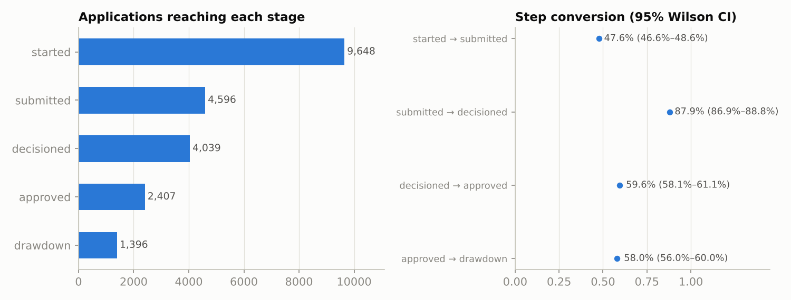
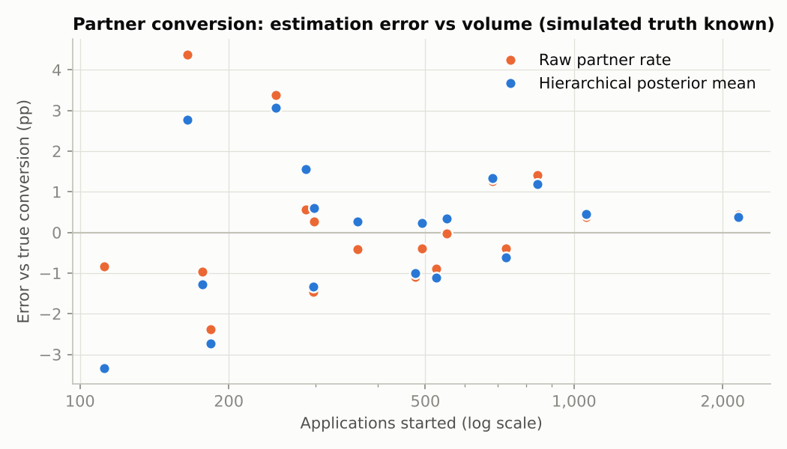
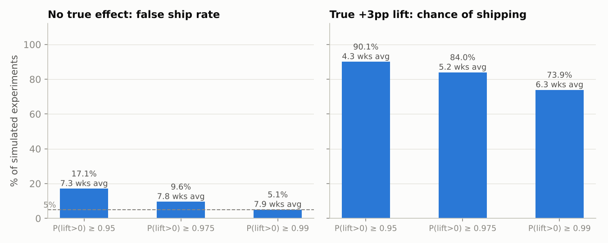

# Partner funnel analysis: where do partner applicants drop off, and how would we test a fix?

An end-to-end analysis of a **partner-sourced SME lending funnel**: the journey from a business starting an application inside a partner's product to drawing down funds. It covers funnel diagnosis, partner-level estimation with partial pooling, and a sequential Bayesian experiment design for a fix.

> **Synthetic data, stated up front.** Real lending data is private, so the funnel is simulated with known true parameters (`src/simulate.py`). That is deliberate: it lets every method be checked against ground truth. No claim here is about any real company's performance. The funnel stages, partner mix and effect sizes are my assumptions.

## What it does

1. **Funnel diagnosis** (`src/funnel.py`): stage-by-stage conversion with 95% Wilson intervals, and the share of all losses at each step. Also compares auto-decisioned and manual-review routes.
2. **Partner-level conversion with partial pooling** (`src/bayes.py`): a hierarchical logit-normal binomial model, fitted with a Metropolis-within-Gibbs sampler written in numpy. It runs four chains and reports R-hat and ESS.
3. **Experiment design for the biggest leak** (`src/experiment.py`): a weekly-look sequential Bayesian rule, with its false-positive rate and power measured by simulation rather than assumed.

## Findings (simulated data, 18 partners, 9,648 applications started)

**The biggest leak is at the start.** Only 47.6% (95% CI 46.6–48.6%) of started applications are submitted. That step accounts for **61% of all lost applications**. End-to-end, 14.5% of started applications reach drawdown.



| Step | Conversion | Share of all losses |
|---|---|---|
| started → submitted | 47.6% | 61.2% |
| submitted → decisioned | 87.9% | 6.7% |
| decisioned → approved | 59.6% | 19.8% |
| approved → drawdown | 58.0% | 12.3% |

**Routing looks important, but the comparison is not causal.** Auto-decisioned applications convert from decision to drawdown at 43.6%, against 22.7% for manual review. In real data, applications sent to manual review are different (usually riskier), so this gap would not show what routing *causes*. It would need an experiment or a quasi-experiment, which is what the sibling repo [`topup-causal-inference`](https://github.com/Max-Isse/topup-causal-inference) is about.

**Partial pooling helps, but modestly.** Over 50 simulated worlds (900 partner estimates), the hierarchical posterior mean has an RMSE of 2.49pp against 2.72pp for the raw partner rate, about 8% lower. For partners with under 500 started applications (55% of them) it is 3.16pp against 3.49pp. In the example world, some of the very smallest partners get *worse* (see below), so the gain is an average, not a guarantee.



**Calibration: neither interval type reaches its nominal level.** The 90% intervals covered the true partner conversion 87.2% of the time for the hierarchical model and 88.1% for Wilson intervals. The hierarchical model is *not* better calibrated here. The likely reason is misspecification: true conversion is a product of stage probabilities with partner-level noise, which a single logit-normal does not capture exactly. A better next step would be a model with stage-specific partner effects.

**Flagging partners.** Using P(partner conversion < portfolio rate) ≥ 0.95, the model flags 8 partners, and all 8 are truly below the portfolio rate in the simulation. It does not flag two other partners that are truly below (P10 and P18), because there is too little data to be sure. That is the intended behaviour: it flags only what the data supports.

**Sampler diagnostics (example world):** R-hat is 1.00 for both μ and τ; ESS is about 10,800 for μ and 7,800 for τ.

## Sequential experiment: peeking has a price

Hypothetical fix: pre-filling the application from partner data to lift started → submitted from a baseline of 47.6%. With 400 applicants per arm per week and weekly looks for up to 10 weeks:



| Ship if P(lift > 0) ≥ | False-ship rate (no effect) | Chance of shipping at a true +3pp | Avg. weeks at +3pp |
|---|---|---|---|
| 0.95 | **17.1%** | 90.1% | 4.3 |
| 0.975 | 9.6% | 84.0% | 5.2 |
| 0.99 | 5.1% | 73.9% | 6.3 |

- A fixed-horizon test for +3pp at 80% power and α = 0.05 needs **4,359 applicants per arm**, which is more than the 4,000 per arm available in 10 weeks. For +1pp it would need 39,189 per arm.
- Checking weekly with the "obvious" 95% rule gives a **17% false-ship rate**, far above the 5% people expect. A stricter threshold brings it back to about 5%, at the cost of power. That trade-off is the main point of the exercise.
- The +3pp lift is an assumed design effect, not an estimate.

## Limitations

- Simulated data. The partner structure, effect sizes and routing effect are assumptions I chose. Real funnels have time effects, seasonality, correlated partners and dependence between stages that this simulation leaves out.
- The hierarchical model has no partner covariates (partner type, product, integration age).
- The experiment design treats arms as independent and the baseline rate as known and fixed.
- The sampler is hand-written for transparency. For production work I would use PyMC or Stan.
- Built with AI assistance (Claude). The code is tested against known answers (see `tests/`), and all numbers above come from `run_all.py`.

## Run it

```bash
pip install -r requirements.txt
python run_all.py          # about 30 seconds; regenerates figures/ and results/
python tests/test_core.py  # 5 checks against known values
```

Developed with Python 3.11.15, numpy 2.2.6, pandas 3.0.2, scipy 1.13.1 and matplotlib 3.10.9.

## Layout

```
src/simulate.py     synthetic partner funnel with known truth
src/funnel.py       stage and route tables, Wilson intervals
src/bayes.py        hierarchical binomial model (Metropolis-within-Gibbs), R-hat, ESS
src/experiment.py   sequential Bayesian experiment and operating characteristics
src/style.py        plot style
run_all.py          reproduces every number and figure
tests/test_core.py  checks against known values
results/            tables, JSON summary, run log
figures/            charts used above
```
